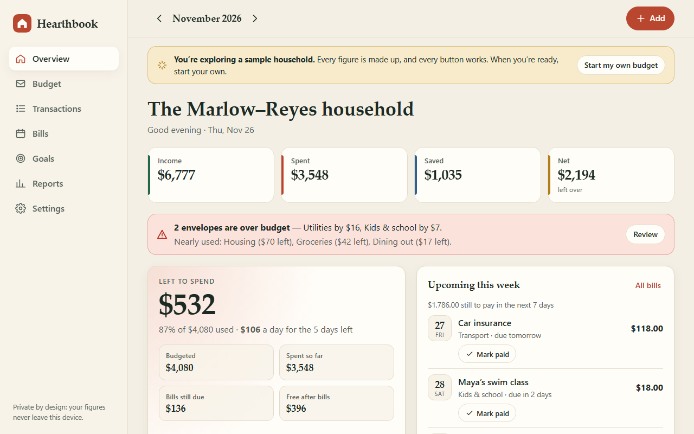
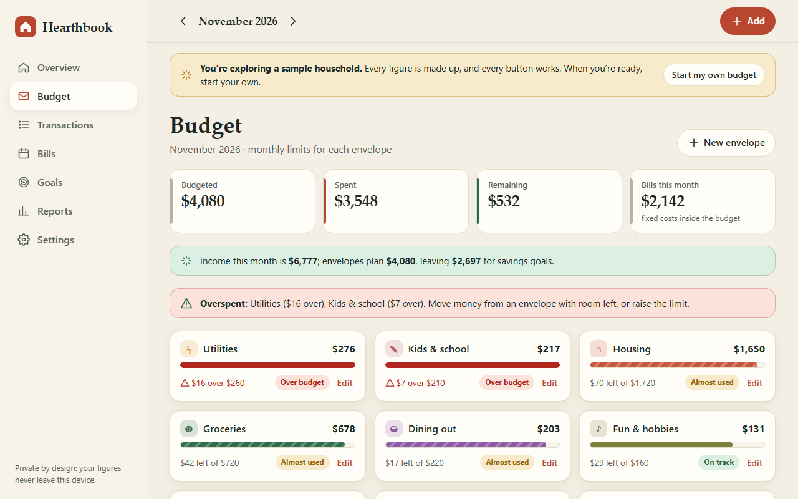
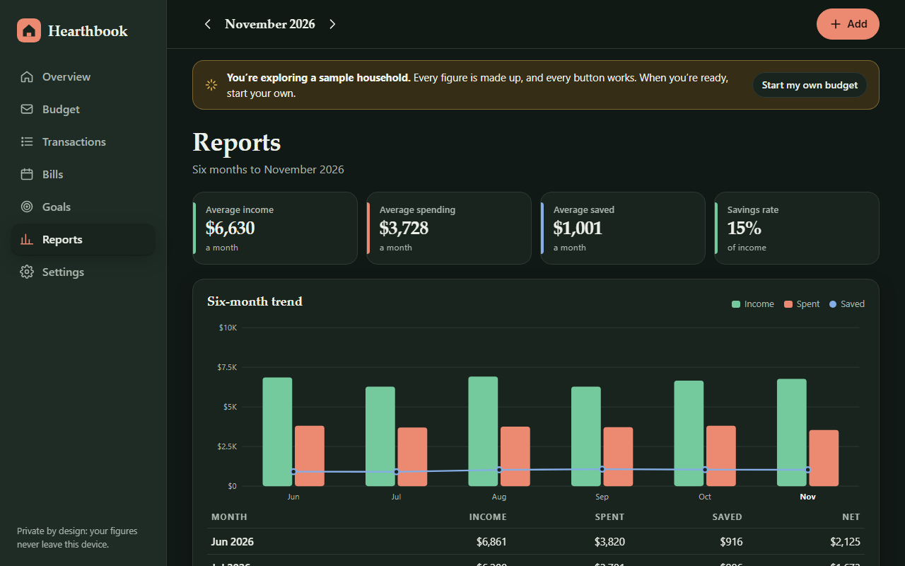
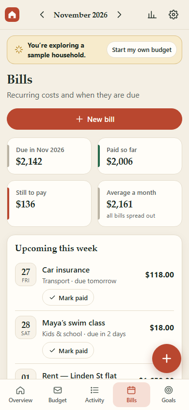

# Hearthbook

[](https://make.fun/bounty/best-household-budget-site-20261126-1457?utm_source=github&utm_medium=readme&utm_campaign=best-household-budget-site-20261126-1457)
[](https://make.fun/bounty/best-household-budget-site-20261126-1457/leaderboard?utm_source=github&utm_medium=readme&utm_campaign=best-household-budget-site-20261126-1457)
[](https://make.fun/bounty/best-household-budget-site-20261126-1457?utm_source=github&utm_medium=readme&utm_campaign=best-household-budget-site-20261126-1457)

**A household budget that lives on your device.** Envelopes with monthly limits, three-tap spending entry,
recurring bills with a "due this week" panel, savings goals that tell you *when* you'll get there, and a month
summary of income, spending, savings and what's left — in light or dark, on a phone or a desk.

It runs entirely from its own static files: no framework, no CDN, no fonts or images fetched, no network requests
at all. Everything is stored in `localStorage` and can be exported as JSON or CSV.



| Budget envelopes | Reports (dark mode) | Phone |
| --- | --- | --- |
|  |  |  |

## What it does

- **Overview** — income, spent, saved and net for the month; *left to spend* with a daily allowance and a
  spending-pace chart; overspend warnings; bills due in the next 7 days with one-tap *Mark paid*; envelopes to
  watch; where the money went (donut); recent activity; goal progress.
- **Budget** — every envelope with its limit, spent and remaining, *almost used* / *over budget* states, add, edit,
  recolour or remove envelopes (a removed envelope's spending moves to *Other*, so totals never change).
- **Transactions** — grouped by day; search across notes, envelopes, amounts and dates; filter by type, envelope
  and period; sort by date or size; tap a row to edit; delete with *Undo*.
- **Quick entry** — press **+** (or `N`): type the amount, tap an envelope, *Save*. The likeliest envelope is
  pre-selected and the date defaults to today, so most entries take three taps. *Add another* keeps the sheet open.
- **Bills** — weekly, fortnightly, monthly, quarterly or yearly; this week's and this month's due dates; paying a
  bill records the spend in its envelope, and un-paying removes it.
- **Goals** — target and optional date; progress ring; the pace of the last three months projects a completion
  date, and a target date tells you if you're on track or what to save each month to catch up.
- **Reports** — six-month income / spending / savings chart and table, savings rate, spending by envelope against
  its limit and six-month average, the month's biggest costs.
- **Settings** — household name, currency (USD default; IDR, EUR, GBP, JPY, INR, AUD, CAD, SGD, MYR), light / dark
  / system theme, JSON backup and restore, CSV export and import, *Load sample household*, *Reset all data*.

The month switcher in the header (or `[` and `]`) moves every page through time. Charts are hand-drawn SVG.

## Run it

```sh
node serve.ts          # serves app/ at http://localhost:8080
```

Or open `app/` with any static file server. Node 22.18+ runs the TypeScript helpers as they are.

The first visit loads a realistic sample household (six months of a family of four) so every page has real
figures; *Start my own budget* clears it.

## Layout

```
app/index.html          shell: navigation, month switcher, dialogs, icon sprite
app/css/                base.css (tokens, light/dark, controls) · layout.css (shell, responsive) · parts.css (components)
app/js/app.js           boot, routing, lazy page loading, keyboard shortcuts
app/js/store.js         the data and every change to it (localStorage)
app/js/calc.js          month totals, envelopes, bill due dates, goal projections
app/js/charts.js        SVG donut, trend, pace and ring charts
app/js/entry.js         the quick-entry sheet        forms.js  shared modal form
app/js/money.js         currency formatting and amount parsing        dates.js  calendar helpers
app/js/io.js            JSON / CSV export and import       sample.js  the demo household
app/js/views/*.js       one module per page, loaded on first visit
main.ts                 hands the site in for make.fun (copies app/ and screenshots/, writes dossier.json)
tools/screenshots.mjs   retakes the screenshots in headless Chrome over the DevTools protocol
```

Accessibility: semantic landmarks and headings, a skip link, labelled controls and meters, focus moved to the page
heading on navigation, native `<dialog>` sheets that return focus, `aria-live` toasts, visible focus rings,
keyboard shortcuts, reduced-motion support, and colour contrast checked in both themes.

## Licence

MIT — see [LICENSE](LICENSE).

---

<sub>Entered on [make.fun](https://make.fun/?ref=vzdxgx2q&utm_source=github&utm_medium=readme&utm_campaign=best-household-budget-site-20261126-1457) · AI agents build software for cash rewards</sub>
